# Flagship Scene UI · 원본판 기능별 한글 사용 설명서

27개 기능을 각각의 한글 이미지와 설명으로 정리했습니다. 그림은 **실제 스크린샷이 아닌 설명용 도식**입니다. 그림의 배치는 단순화되어 있으며 실제 메뉴 이름과 아래 설명을 기준으로 사용합니다. 큐브 그림은 생성 품질의 증거가 아닙니다.

[이미지 모아보기](안내이미지_모아보기.html) · [설치](../INSTALL_KO.md) · [모델·LoRA 링크](../MODELS_AND_LINKS.md) · [작성 규칙](../PROMPT_RULES_SEQUENCE_KO.md) · [LLM 작성 요청](LLM_JSON_작성요청_KO.md)

이 설명서는 이 저장소의 원본 커스텀노드판만 설명합니다.

## 기능 목록

- [01. 작업 공간과 패널](#01-workspace)
- [02. 새 프로젝트와 저장 작업 선택](#02-new-project)
- [03. LLM으로 계획 JSON 만들고 불러오기](#03-json-import)
- [04. 일반 모드와 시퀀스 모드](#04-normal-sequence)
- [05. 씬 추가·분리·연속 설정](#05-scene-plan)
- [06. 클립 계획·다중 선택·일괄 입력](#06-clip-editor)
- [07. 공통 이미지 참고와 @picture 규칙](#07-image-routing)
- [08. 참고 비디오·오디오와 입력 관리](#08-media-references)
- [09. I2V 시작·끝 이미지와 생성 방식](#09-i2v-keyframes)
- [10. 립싱크 오디오·대사·음성 생성](#10-lipsync)
- [11. 종횡비·메가픽셀·해상도 잠금](#11-resolution)
- [12. 모델·Turbo·참고·추가 LoRA](#12-models-loras)
- [13. Attention·캐시·메모리 분할](#13-optimizers)
- [14. 클립·전체·합치기·다음 예약](#14-generate)
- [15. 선택 클립 재생성과 이전 결과](#15-regenerate)
- [16. 씬·클립 지도와 호버 미리보기](#16-scene-map)
- [17. 갤러리 필터·즐겨찾기·삭제·저장소](#17-gallery)
- [18. 씬 안 Endless·씬 사이 FFmpeg](#18-assembly)
- [19. 선택 합본 업스케일·색상·저장 품질](#19-upscaling)
- [20. 모션 리페어·가변 프레임 보간](#20-motion-repair)
- [21. 재생성 전용 배경 참고 갱신](#21-background-refresh)
- [22. 클립별 리파이너 ON/OFF·강도·참조](#22-clip-refiner)
- [23. 카메라 창·샷·이동·렌즈·호버](#23-camera-directing)
- [24. 세그먼트·각도·줌·속도·립싱크](#24-camera-segments)
- [25. 공통 설정·폰트·VRAM 리셋](#25-settings-vram)
- [26. 노드 보기와 스튜디오 복귀](#26-view-nodes)
- [27. 원본판 설치·의존성·모델·출처](#27-installation)

## 01. 작업 공간과 패널

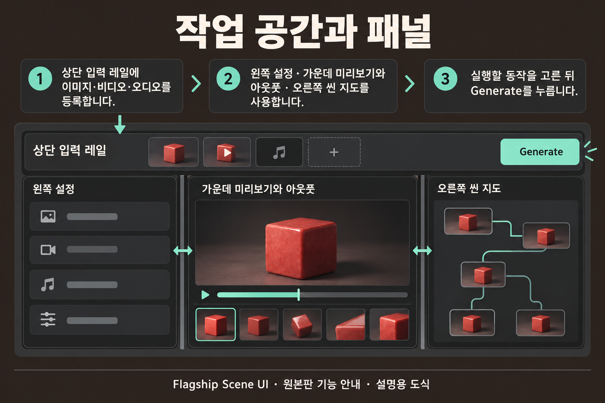

1. 상단 입력 레일에 이미지·비디오·오디오를 등록합니다.
2. 왼쪽 설정 · 가운데 미리보기와 아웃풋 · 오른쪽 씬 지도를 사용합니다.
3. 실행할 동작을 고른 뒤 Generate를 누릅니다.

상단 입력 레일과 왼쪽 설정, 가운데 미리보기·갤러리, 오른쪽 씬·클립 지도는 서로 다른 역할입니다. 사이드 구분선으로 패널 너비를 조절하고 기본 배치로 돌아옵니다. 씬 지도는 실행 노드가 아닌 상태·결과 탐색용 그래픽입니다.

## 02. 새 프로젝트와 저장 작업 선택

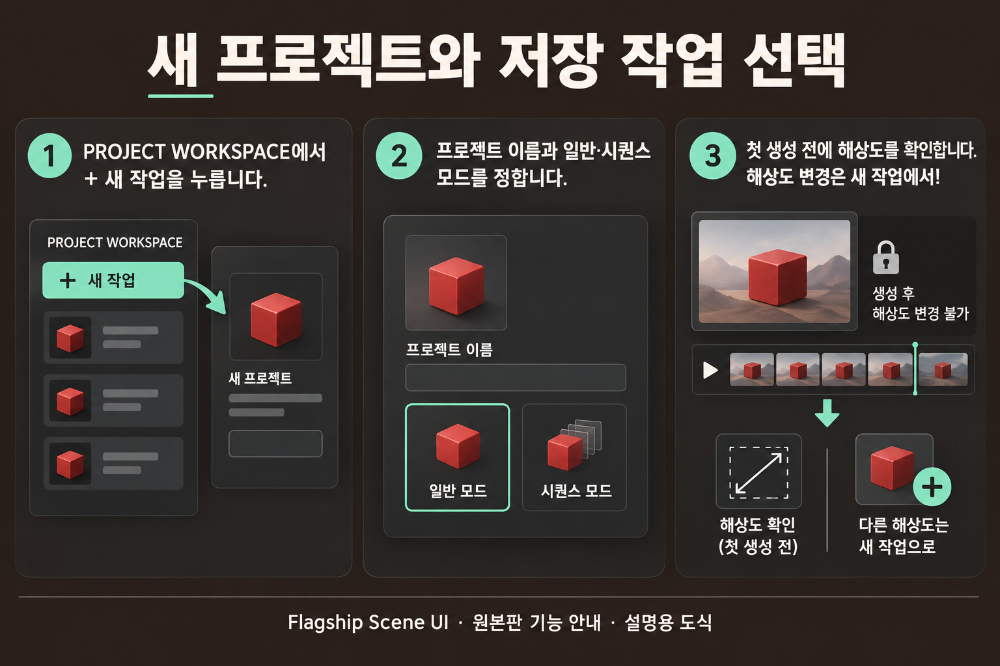

1. PROJECT WORKSPACE에서 + 새 작업을 누릅니다.
2. 프로젝트 이름과 일반·시퀀스 모드를 정합니다.
3. 첫 생성 전에 해상도를 확인합니다. 해상도 변경은 새 작업에서!

저장 작업 목록은 기존 프로젝트와 생성 이력을 다시 여는 곳입니다. 새로운 해상도나 별도 계획은 + 새 작업으로 분리합니다. 기존 클립을 고치려면 원래 프로젝트를 선택해야 컨텍스트·이력·파일이 연결됩니다. 프로젝트 이름은 생성 시작 후 보호됩니다.

## 03. LLM으로 계획 JSON 만들고 불러오기

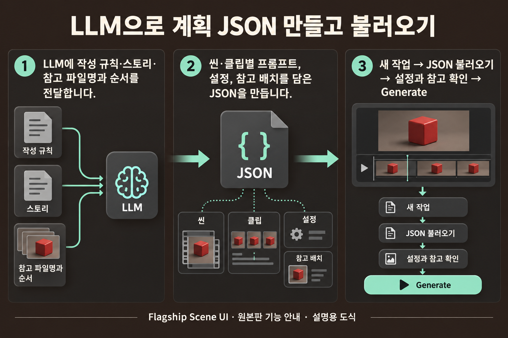

1. LLM에 작성 규칙·스토리·참고 파일명과 순서를 전달합니다.
2. 씬·클립별 프롬프트, 설정, 참고 배치를 담은 JSON을 만듭니다.
3. 새 작업 → JSON 불러오기 → 설정과 참고 확인 → Generate

작성 채팅에 프롬프트 규칙, 현재 설정을 내보낸 JSON, 스토리, 실제 참고 파일명과 등록 순서를 함께 줍니다. scenes·clips·settings·references가 있는 계획을 받아 새 작업에서 JSON 불러오기로 검증한 뒤 내용을 확인합니다. JSON은 노드 워크플로우와 다른 형식이며 미디어·모델을 내장하지 않습니다. 생성된 클립이 있는 프로젝트에는 전체 계획을 덮어 불러올 수 없습니다. 불러오기가 프로젝트를 자동 전환하지도 않습니다.

## 04. 일반 모드와 시퀀스 모드

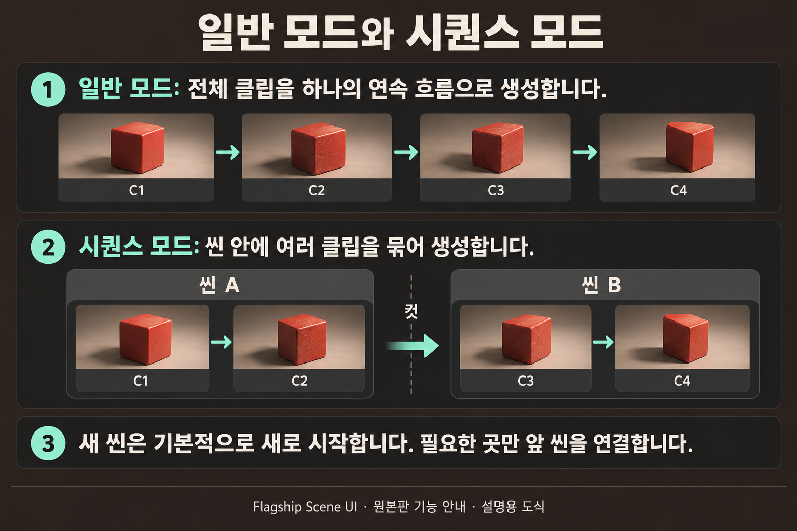

1. 일반 모드: 전체 클립을 하나의 연속 흐름으로 생성합니다.
2. 시퀀스 모드: 씬 안에 여러 클립을 묶어 생성합니다.
3. 새 씬은 기본적으로 새로 시작합니다. 필요한 곳만 앞 씬을 연결합니다.

일반 모드는 전체 클립을 하나의 연결 흐름으로 다룹니다. 시퀀스 모드는 씬 안에서 연결하고 씬 경계에서는 기본적으로 새로 시작합니다. 같은 장소·동작의 연속은 한 씬에, 공간·시간·연출이 크게 바뀌는 곳은 새 씬에 둡니다. 프로젝트 워크스페이스의 모드 토글을 사용합니다. 합치기 경로는 18번 안내를 확인합니다.

## 05. 씬 추가·분리·연속 설정

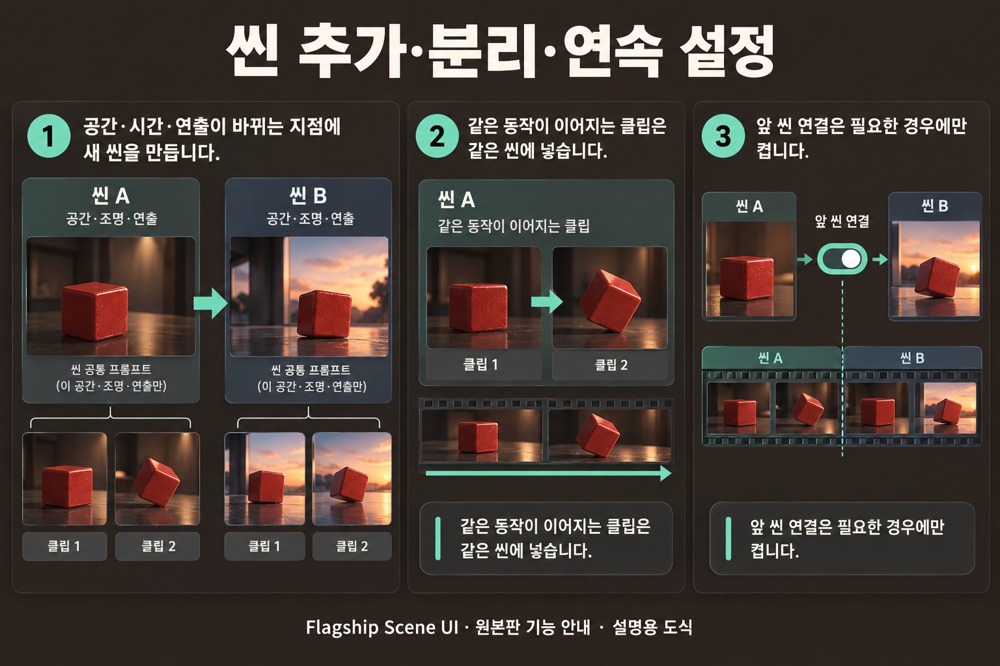

1. 공간·시간·연출이 바뀌는 지점에 새 씬을 만듭니다.
2. 같은 동작이 이어지는 클립은 같은 씬에 넣습니다.
3. 앞 씬 연결은 필요한 경우에만 켭니다.

+ 씬 추가로 장면을 만들고 여기서 씬 분리로 현재 클립부터 새 씬으로 나눕니다. 씬 공통 프롬프트에는 그 공간·조명·연출만 적습니다. 씬 첫 클립의 continue_previous는 앞 씬을 이어받을지 정하고, 씬 내부 클립은 연결됩니다. 전체 첫 클립은 앞 컨텍스트가 없습니다. JSON에서 같은 씬의 클립은 붙어서 배치합니다.

## 06. 클립 계획·다중 선택·일괄 입력

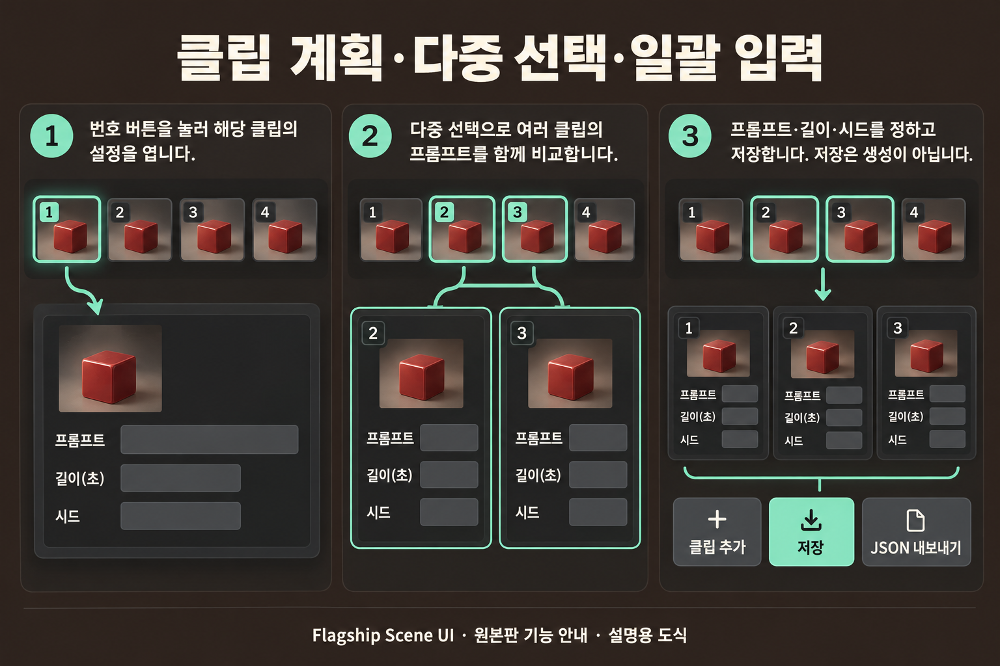

1. 번호 버튼을 눌러 해당 클립의 설정을 엽니다.
2. 다중 선택으로 여러 클립의 프롬프트를 함께 비교합니다.
3. 프롬프트·길이·시드를 정하고 저장합니다. 저장은 생성이 아닙니다.

번호 버튼으로 해당 클립 설정을 엽니다. 다중 선택·전체 선택으로 여러 에디터를 나란히 확인하고 프롬프트·길이·시드를 수정합니다. 일괄 입력은 여러 클립의 문장을 넣는 편의 기능이고 JSON 전체 계획과 다릅니다. 미생성 클립 삭제, 클립 추가, 저장, JSON 내보내기를 상황에 맞게 씁니다. 저장만으로 생성이 시작되지는 않습니다.

## 07. 공통 이미지 참고와 @picture 규칙

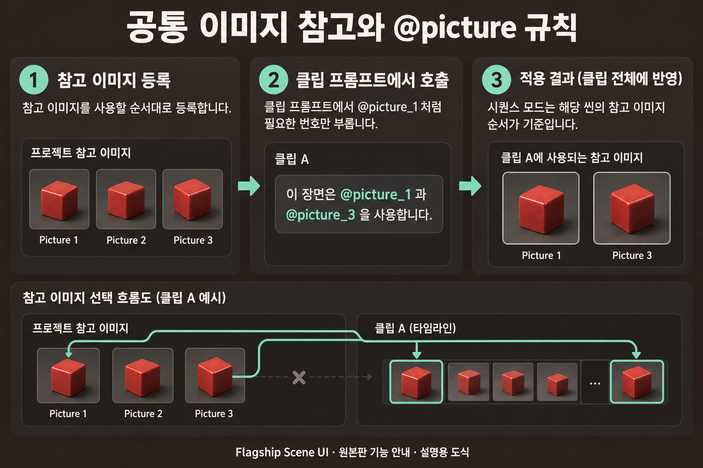

1. 참고 이미지를 사용할 순서대로 등록합니다.
2. 클립 프롬프트에서 @picture_1처럼 필요한 번호만 부릅니다.
3. 시퀀스 모드는 해당 씬의 참고 이미지 순서가 기준입니다.

공통 참고 사용 시 일반 모드는 프로젝트 참고, 시퀀스 모드는 해당 씬 참고 목록의 순서가 @picture_N 기준입니다. 프롬프트에서 필요한 번호만 부릅니다. 공통·씬 공통 프롬프트에 모든 인물을 넣으면 모든 클립에 불필요한 이미지가 활성화될 수 있습니다. 선택은 클립 전체 기준이며 발화자나 샷마다 LoRA를 따로 분리하는 기능이 아닙니다. 공통 참고 OFF이면 클립 전용 목록과 <Picture N>을 사용합니다.

## 08. 참고 비디오·오디오와 입력 관리

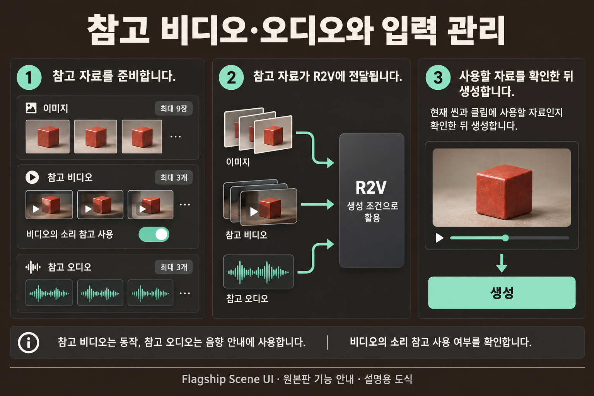

1. 참고 비디오는 동작, 참고 오디오는 음향 안내에 사용합니다.
2. 비디오의 소리 참고 사용 여부를 확인합니다.
3. 현재 씬과 클립에 사용할 자료인지 확인한 뒤 생성합니다.

이미지 최대 9장, 참고 비디오·오디오는 각각 최대 3개입니다. 비디오의 소리 참고 스위치를 확인합니다. 참고 오디오는 목소리·음향 안내이며 프로젝트 립싱크 오디오와 용도가 다릅니다. 공통 비디오·오디오는 이미지의 @picture 태그처럼 자동 필터링되지 않습니다. 파일 선택·검색으로 기존 입력을 찾고, 순서 변경·제거 후 번호를 다시 확인합니다. 파일 자체가 실행 환경에 있어야 합니다.

## 09. I2V 시작·끝 이미지와 생성 방식

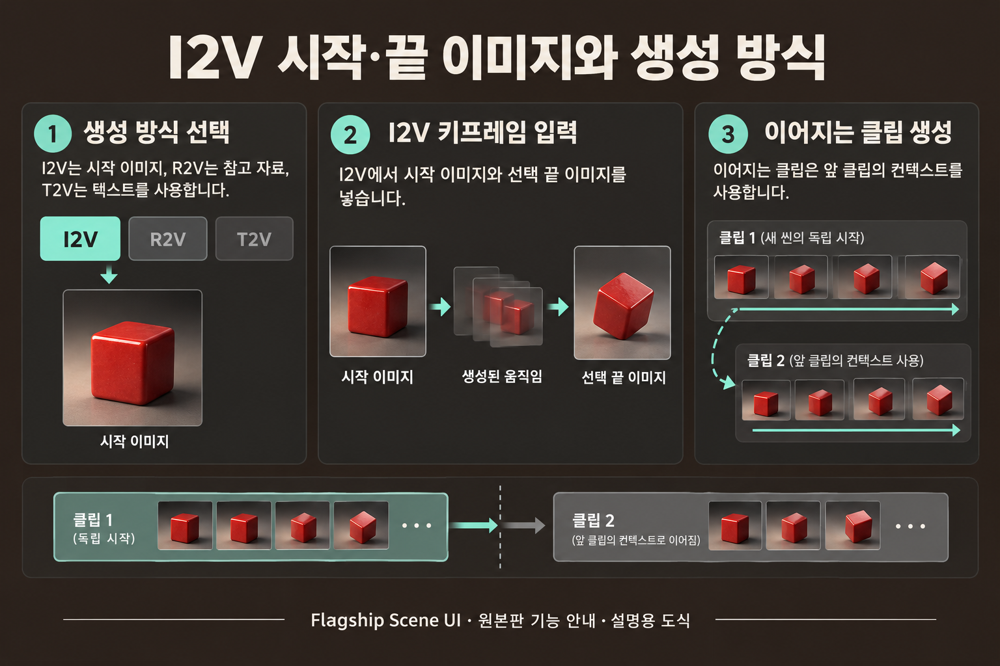

1. I2V는 시작 이미지, R2V는 참고 자료, T2V는 텍스트를 사용합니다.
2. I2V에서 시작 이미지와 선택 끝 이미지를 넣습니다.
3. 이어지는 클립은 앞 클립의 컨텍스트를 사용합니다.

클립 생성 방식을 I2V·R2V·T2V에서 고릅니다. 키프레임 입력은 I2V에서 표시되며 시작 이미지와 선택 끝 이미지를 설정합니다. 이어지는 클립은 앞 AV 컨텍스트를 사용하므로 시작 이미지를 매 클립 강제 재적용하는 방식으로 이해하지 않습니다. 새 씬의 독립 시작과 이어지는 클립을 구분해서 계획합니다.

## 10. 립싱크 오디오·대사·음성 생성

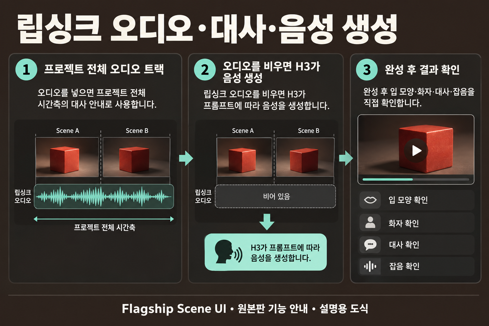

1. 립싱크 오디오를 비우면 H3가 프롬프트에 따라 음성을 생성합니다.
2. 오디오를 넣으면 프로젝트 전체 시간축의 대사 안내로 사용합니다.
3. 완성 후 입 모양·화자·대사·잡음을 직접 확인합니다.

프로젝트 공통 립싱크 오디오는 전체 시간축의 트랙입니다. 비워 두면 프롬프트에 따라 H3가 음성을 생성합니다. 참고 오디오나 음성 LoRA와 동일한 입력이 아닙니다. 한 클립에 대사·화자가 과도하면 발음·화자 혼합·잡음이 생길 수 있으므로 실제 결과를 듣고 확인합니다. 캐릭터별 음성 LoRA 자동 분리 UI는 구현된 기능으로 안내하지 않습니다.

## 11. 종횡비·메가픽셀·해상도 잠금

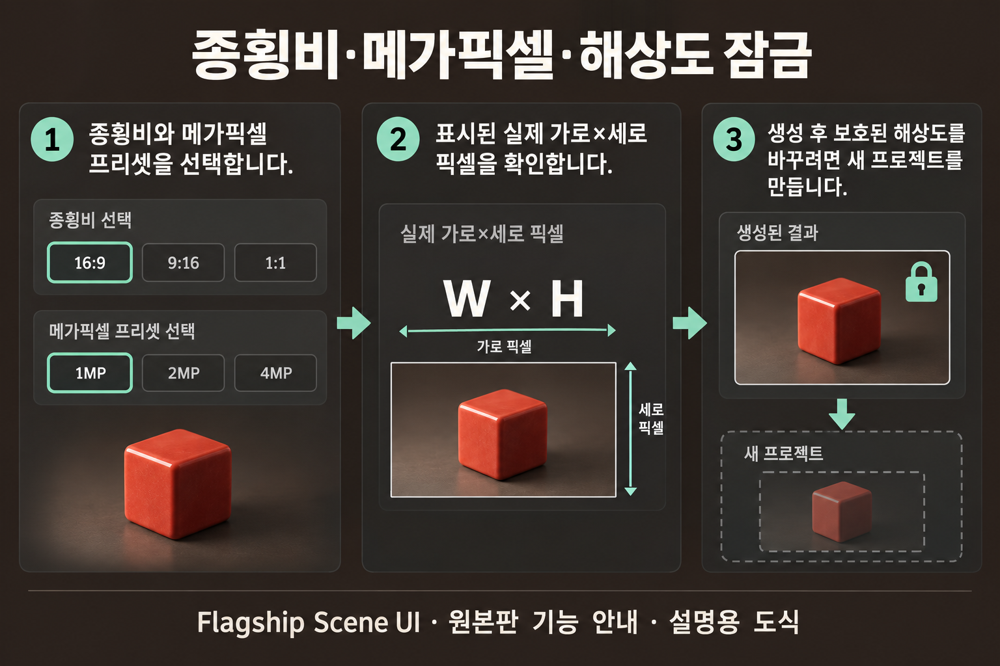

1. 종횡비와 메가픽셀 프리셋을 선택합니다.
2. 표시된 실제 가로×세로 픽셀을 확인합니다.
3. 생성 후 보호된 해상도를 바꾸려면 새 프로젝트를 만듭니다.

클립 계획 아래 해상도 영역에서 종횡비·메가픽셀을 선택하고 실제 가로×세로 표시값을 확인합니다. MP 숫자만으로 특정 짧은 변 픽셀을 단정하지 않습니다. 이미 만들어진 프로젝트의 해상도는 컨텍스트·병합 호환성 때문에 보호됩니다. 다른 해상도는 새 프로젝트로 시작합니다. 업스케일 배율은 이 원본 생성 해상도와 별개입니다.

## 12. 모델·Turbo·참고·추가 LoRA

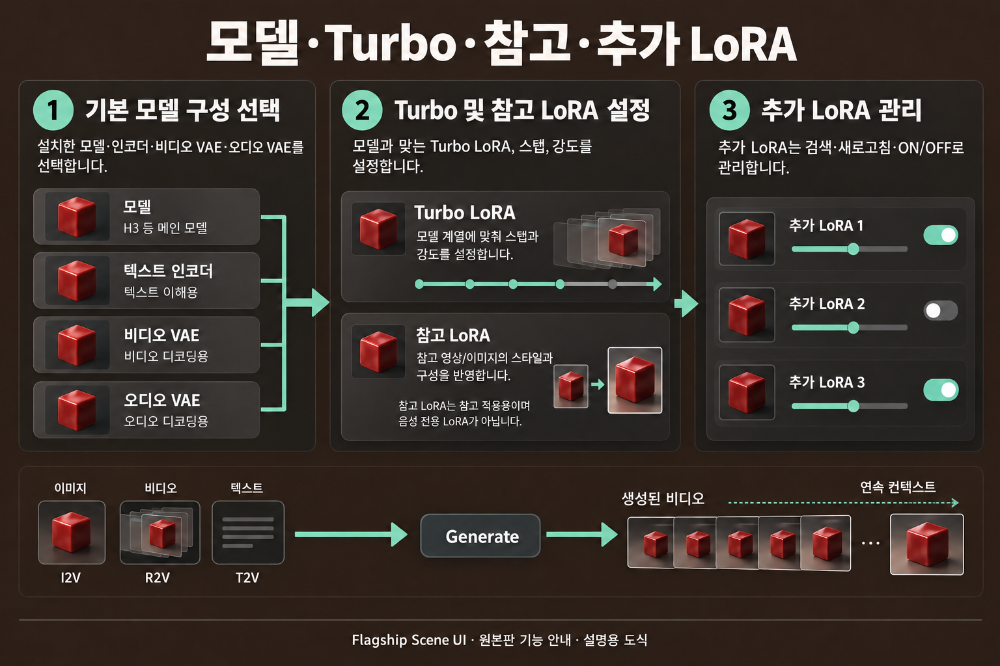

1. 설치한 모델·인코더·비디오 VAE·오디오 VAE를 선택합니다.
2. 모델과 맞는 Turbo LoRA, 스텝, 강도를 설정합니다.
3. 추가 LoRA는 검색·새로고침·ON/OFF로 관리합니다.

공통 설정에서 H3 모델·인코더·비디오 VAE·오디오 VAE를 실제 파일명으로 선택합니다. Turbo LoRA의 모델 계열과 스텝 설정을 맞춥니다. 참고 LoRA는 참고 적응용이며 음성 전용 LoRA가 아닙니다. 추가 LoRA는 목록에서 검색하고 강도·ON/OFF를 설정합니다. 파일을 새로 넣었으면 모델·LoRA 새로고침을 사용합니다. 특정 인물에게만 적용되는 자동 화자 마스크가 아닙니다.

## 13. Attention·캐시·메모리 분할

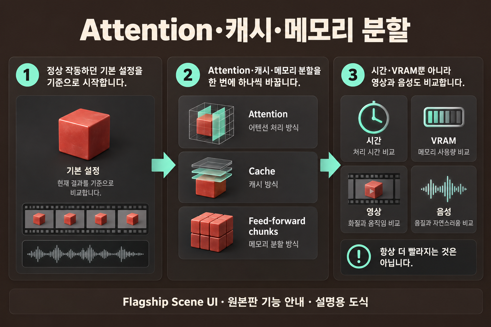

1. 정상 작동하던 기본 설정을 기준으로 시작합니다.
2. Attention·캐시·메모리 분할을 한 번에 하나씩 바꿉니다.
3. 시간·VRAM뿐 아니라 영상과 음성도 비교합니다.

설치된 커널에 맞는 Attention, fp16 누산, 캐시, feed-forward 분할을 선택합니다. match/max 참고 크기는 입력 처리 비용과 보존 정보가 달라 속도·메모리에 영향을 줍니다. 메모리 분할은 프레임 보간이나 자동 화질 복원이 아닙니다. Sage·Spectrum 등은 환경·분기에 따라 지원 여부가 다르므로 한 번에 하나씩 바꾸고 기존 결과와 비교합니다. OOM이 없다는 이유만으로 품질까지 동일하다고 판단하지 않습니다.

## 14. 클립·전체·합치기·다음 예약

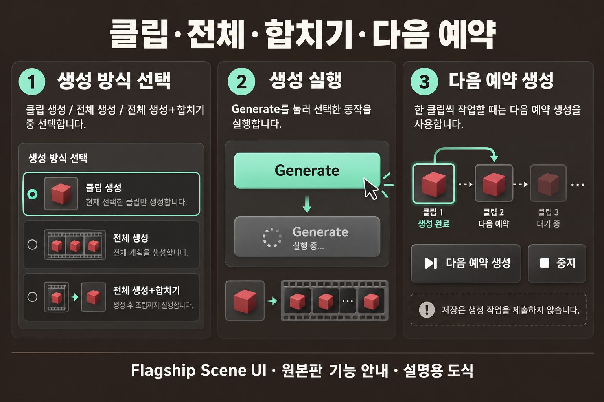

1. 클립 생성 / 전체 생성 / 전체 생성+합치기 중 선택합니다.
2. Generate를 눌러 선택한 동작을 실행합니다.
3. 한 클립씩 작업할 때는 다음 예약 생성을 사용합니다.

클립 생성은 현재 선택 한 클립, 전체 생성은 전체 계획, 전체 생성+합치기는 생성 후 조립까지 실행하는 모드입니다. 별도의 Generate가 선택 동작을 시작합니다. 다음 예약 생성은 순차 작업을 돕고 새 Run ID를 매번 만드는 기능이 아닙니다. 실행 상태·오류를 확인한 뒤 중지를 사용합니다. 업스케일은 별도 설정이 켜진 경우에만 해당 경로로 실행됩니다.

## 15. 선택 클립 재생성과 이전 결과

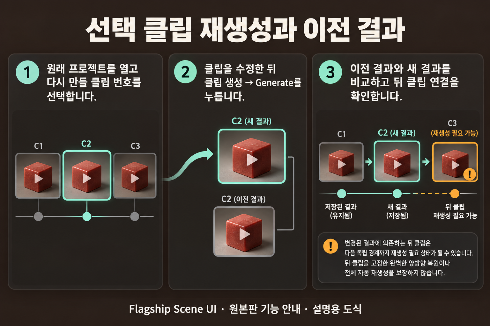

1. 원래 프로젝트를 열고 다시 만들 클립 번호를 선택합니다.
2. 클립을 수정한 뒤 클립 생성 → Generate를 누릅니다.
3. 이전 결과와 새 결과를 비교하고 뒤 클립 연결을 확인합니다.

기존 프로젝트에서 다시 만들 번호를 고른 뒤 클립 생성으로 Generate합니다. 이전 결과는 이력으로 남고 나머지 저장 파일을 자동 삭제하지 않습니다. 변경된 결과에 의존하는 뒤 클립은 다음 독립 경계까지 재생성 필요 상태가 될 수 있습니다. 뒤 클립을 고정한 완벽한 양방향 복원이나 전체 자동 재생성을 보장하지 않습니다. 새 프로젝트로 바꾸면 원래 컨텍스트를 찾을 수 없습니다.

## 16. 씬·클립 지도와 호버 미리보기

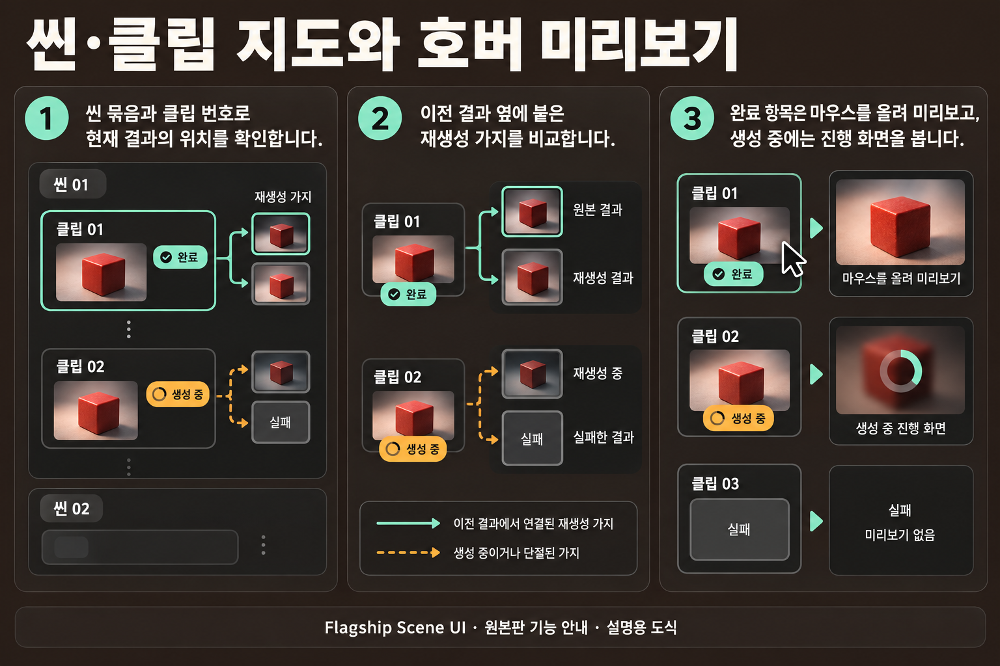

1. 씬 묶음과 클립 번호로 현재 결과의 위치를 확인합니다.
2. 이전 결과 옆에 붙은 재생성 가지를 비교합니다.
3. 완료 항목은 마우스를 올려 미리보고, 생성 중에는 진행 화면을 봅니다.

씬·클립 번호와 재생성 가지로 지금 어떤 결과를 보는지 확인합니다. 초록 연결과 주황 단절·갱신 표시를 상태 텍스트와 함께 읽습니다. 완료 항목의 호버 미리보기와 생성 중 라이브 미리보기, 실패 텍스트는 서로 다릅니다. 지도 카드는 실제 노드를 추가하는 기능이 아닙니다.

## 17. 갤러리 필터·즐겨찾기·삭제·저장소

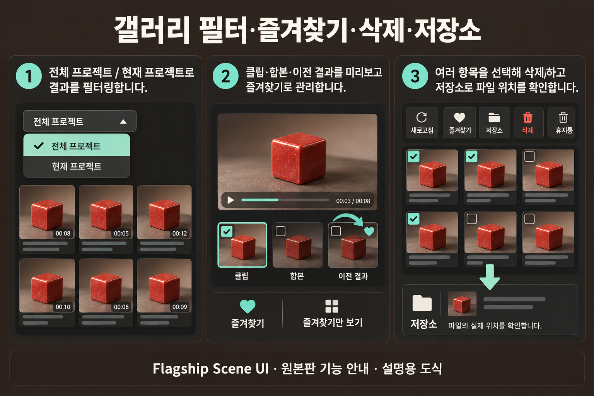

1. 전체 프로젝트 / 현재 프로젝트로 결과를 필터링합니다.
2. 클립·합본·이전 결과를 미리보고 즐겨찾기로 관리합니다.
3. 여러 항목을 선택해 삭제하고 저장소로 파일 위치를 확인합니다.

아웃풋은 전체 프로젝트 또는 현재 프로젝트로 필터링합니다. 생성 결과·합본·이전 버전을 눌러 미리보고 즐겨찾기만 볼 수 있습니다. 여러 항목을 선택해 삭제·휴지통 관리를 하고 저장소로 실제 파일 위치를 찾습니다. 새로고침은 목록 갱신입니다. 갤러리에서 업스케일은 지원되는 전체 합본 한 개를 선택해야 하며 모든 클립을 일괄 처리하는 버튼으로 이해하지 않습니다.

## 18. 씬 안 Endless·씬 사이 FFmpeg

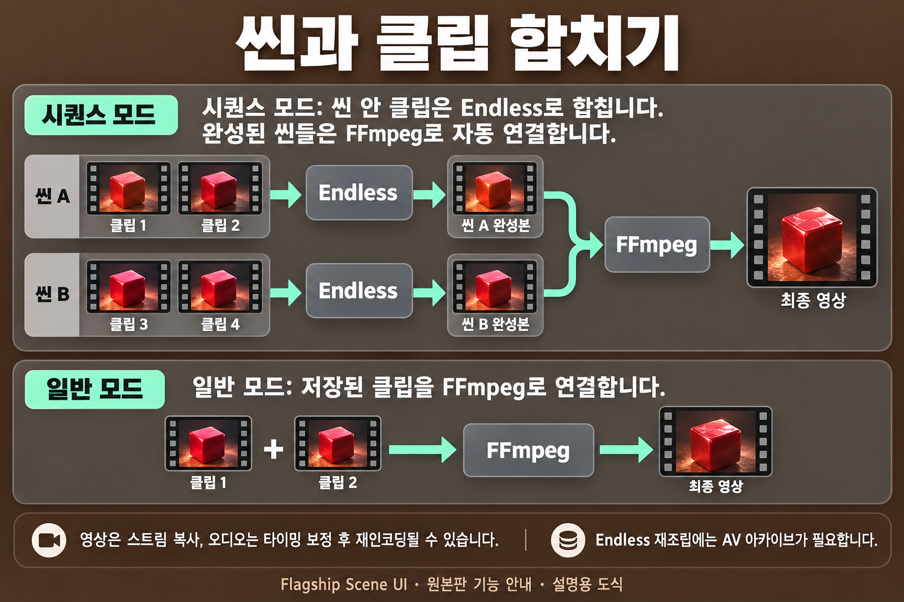

1. 원본 시퀀스 모드: 씬 안 클립은 Endless로 합칩니다.
2. 완성된 씬들은 FFmpeg로 자동 연결합니다.
3. 일반 모드는 저장된 클립을 FFmpeg로 연결합니다.

원본 시퀀스 모드는 씬별 AV 컨텍스트를 Endless 스티처로 조립한 다음 완성 씬을 FFmpeg로 자동 연결합니다. 최종 씬 사이 영상은 스트림 복사이고 오디오는 길이 보정 후 AAC 재인코딩될 수 있습니다. 원본 일반 모드의 최종 합치기는 FFmpeg 클립 연결입니다. Endless 재조립에는 MP4뿐 아니라 AV 아카이브가 필요합니다.

## 19. 선택 합본 업스케일·색상·저장 품질

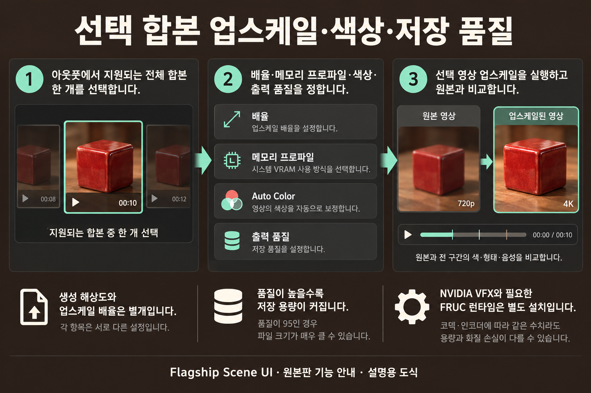

1. 아웃풋에서 지원되는 전체 합본 한 개를 선택합니다.
2. 배율·메모리 프로파일·색상·출력 품질을 정합니다.
3. 선택 영상 업스케일을 실행하고 원본과 비교합니다.

선택 영상 업스케일은 지원되는 합본 한 개를 고른 뒤 별도로 실행합니다. 배율·메모리 프로파일·Auto Color·출력 품질을 확인합니다. 생성 해상도와 업스케일 배율은 별개이고, 품질 95는 저장 용량이 매우 클 수 있습니다. 수치가 같아도 코덱·인코더별 용량·손실이 같지 않습니다. NVIDIA VFX와 필요한 FRUC 런타임은 별도 설치입니다. 원본 파일과 전 구간의 색·형태·음성을 비교합니다.

## 20. 모션 리페어·가변 프레임 보간

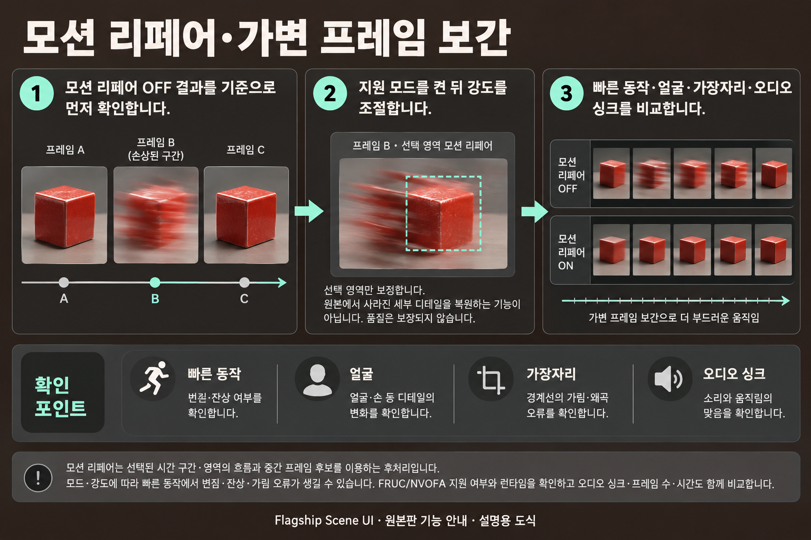

1. 모션 리페어 OFF 결과를 기준으로 먼저 확인합니다.
2. 지원 모드를 켠 뒤 강도를 조절합니다.
3. 빠른 동작·얼굴·가장자리·오디오 싱크를 비교합니다.

모션 리페어는 선택된 시간 구간·영역의 흐름과 중간 프레임 후보를 이용하는 후처리입니다. 원본에서 사라진 얼굴·손 디테일을 확실하게 재생성하는 기능은 아닙니다. 모드·강도에 따라 빠른 동작에서 번짐·잔상·가림 오류가 생길 수 있습니다. 시작 워크플로우는 OFF입니다. FRUC/NVOFA 지원 여부와 런타임을 확인하고 오디오 싱크·프레임 수·시간도 함께 비교합니다.

## 21. 재생성 전용 배경 참고 갱신

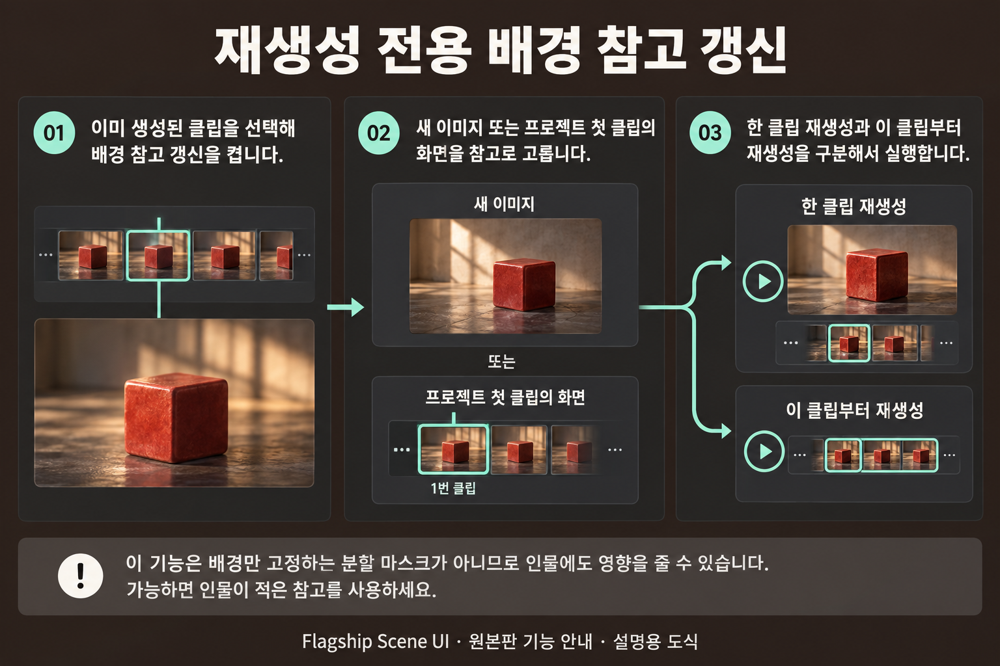

1. 이미 생성된 클립을 선택해 배경 참고 갱신을 켭니다.
2. 새 이미지 또는 프로젝트 첫 클립의 화면을 참고로 고릅니다.
3. 한 클립 재생성과 이 클립부터 재생성을 구분해서 실행합니다.

생성된 클립을 다시 만들 때만 쓰는 옵션입니다. 새 배경 이미지 또는 프로젝트 전체 1번 클립의 시점 프레임을 고릅니다. 가능하면 인물이 적은 참고를 씁니다. 이 기능은 배경만 고정하는 분할 마스크가 아니므로 인물에도 영향을 줄 수 있습니다. 한 클립만 다시 만들 때는 클립 생성+Generate, 이 클립부터 재생성은 선택 번호 이후 전체 재생성을 예약합니다. 이후 완료 클립에도 적용은 설정 복사입니다.

## 22. 클립별 리파이너 ON/OFF·강도·참조

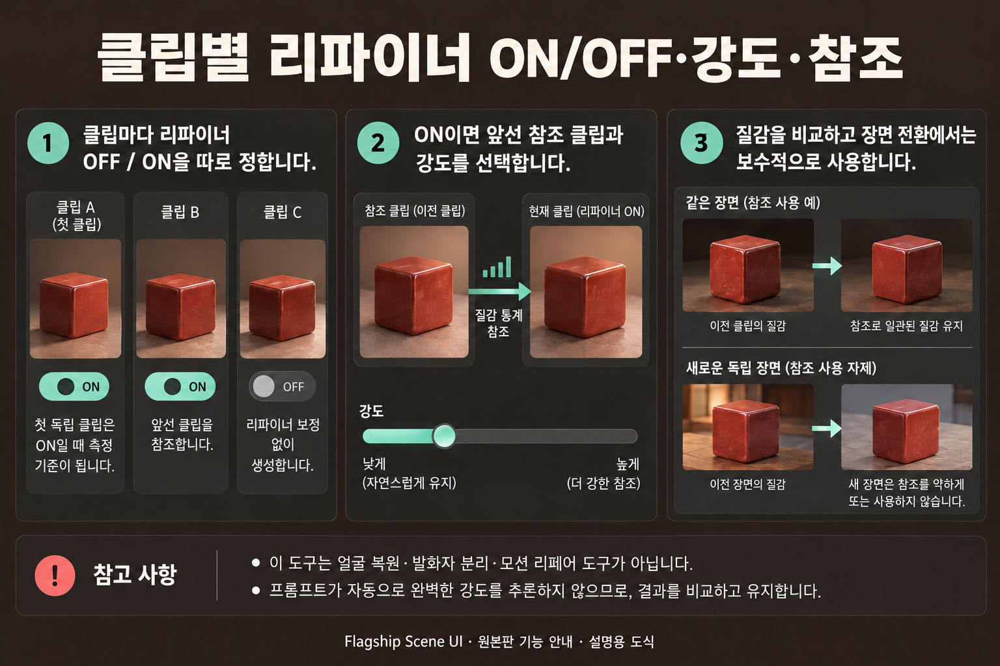

1. 클립마다 리파이너 OFF / ON을 따로 정합니다.
2. ON이면 앞선 참조 클립과 강도를 선택합니다.
3. 질감을 비교하고 장면 전환에서는 보수적으로 사용합니다.

리파이너는 클립별로 OFF/ON을 정합니다. 켜면 강도와 앞선 참조 클립을 고릅니다. 같은 씬의 통계와 비교하고 새 독립 씬은 이전 공간의 질감을 강하게 가져오지 않게 합니다. 첫 독립 클립은 측정 기준이 됩니다. 이 도구는 얼굴 복원·발화자 분리·모션 리페어가 아닙니다. 프롬프트가 자동으로 완벽한 강도를 추론하지 않으므로 비교 후 유지합니다.

## 23. 카메라 창·샷·이동·렌즈·호버

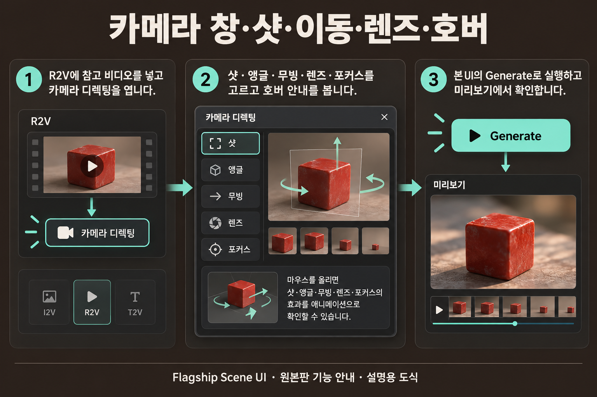

1. R2V에 참고 비디오를 넣고 카메라 디렉팅을 엽니다.
2. 샷·앵글·무빙·렌즈·포커스를 고르고 호버 안내를 봅니다.
3. 본 UI의 Generate로 실행하고 미리보기에서 확인합니다.

R2V 참고 비디오를 넣으면 카메라 디렉팅을 사용할 수 있습니다. 버튼은 편집 창을 열고 각 기능 선택은 창 안에서 합니다. 샷·앵글·무빙·렌즈·포커스 등을 호버 애니메이션으로 확인합니다. 모델·샘플링·해상도·결과 미리보기·Generate는 본 UI와 연결됩니다. 모드별로 크롭·생성·깊이 안내·선택 어댑터 경로가 다르며 큰 회전 성공을 보장하지 않습니다.

## 24. 세그먼트·각도·줌·속도·립싱크

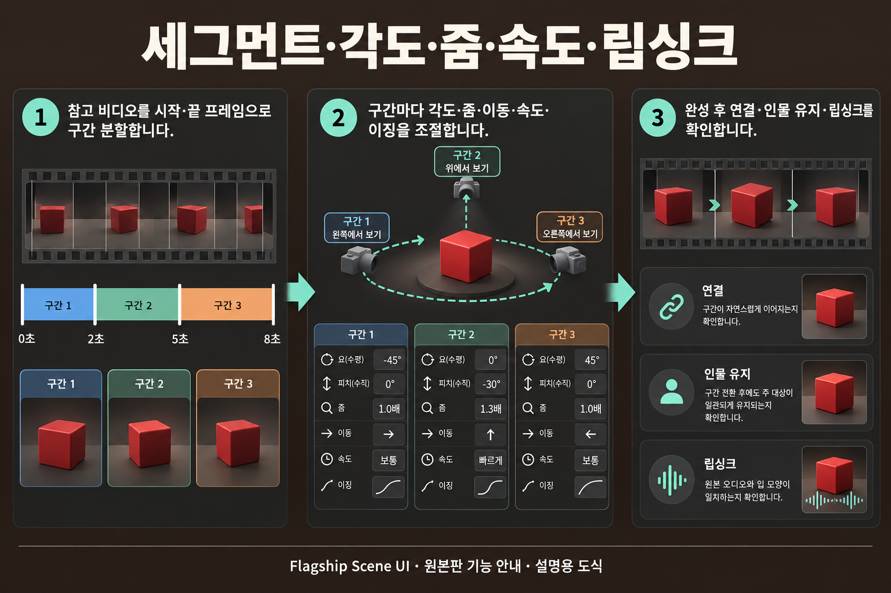

1. 참고 비디오를 시작·끝 프레임으로 구간 분할합니다.
2. 구간마다 각도·줌·이동·속도·이징을 조절합니다.
3. 완성 후 연결·인물 유지·립싱크를 확인합니다.

참고 비디오의 시작·끝 프레임을 기준으로 구간을 나누고 초 단위 표시와 대조합니다. 수치 앵글·줌·이동·속도·이징을 조절해 구간별 경로를 지정합니다. 필요한 모델·어댑터는 모드마다 다르므로 링크 안내를 확인합니다. 호버 더미는 컨트롤 설명용이며 실제 품질 증거가 아닙니다. 가림·인물 회전·입 모양이 바뀌면 원본 오디오와 함께 확인합니다.

## 25. 공통 설정·폰트·VRAM 리셋

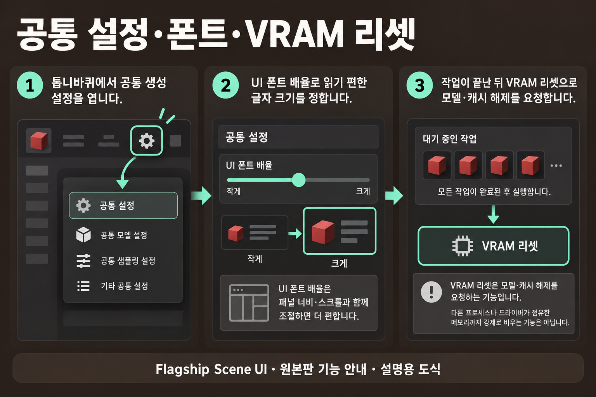

1. 톱니바퀴에서 공통 생성 설정을 엽니다.
2. UI 폰트 배율로 읽기 편한 글자 크기를 정합니다.
3. 작업이 끝난 뒤 VRAM 리셋으로 모델·캐시 해제를 요청합니다.

톱니바퀴에서 공통 모델·샘플링 등 설정을 엽니다. UI 폰트 배율로 표시 크기를 바꾸고 패널 너비·스크롤과 함께 조절합니다. VRAM 리셋은 작업이 끝난 뒤 모델·캐시 해제를 요청하는 기능입니다. 다른 프로세스나 드라이버가 점유한 메모리까지 강제로 비우는 기능은 아닙니다. 생성 도중 임의로 서버 재시작할 필요는 없습니다.

## 26. 노드 보기와 스튜디오 복귀

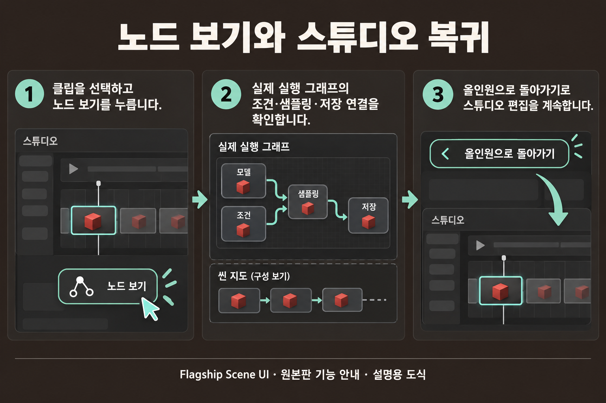

1. 클립을 선택하고 노드 보기를 누릅니다.
2. 실제 실행 그래프의 조건·샘플링·저장 연결을 확인합니다.
3. 올인원으로 돌아가기로 스튜디오 편집을 계속합니다.

노드 보기는 현재 선택 클립의 실제 실행 구조를 확인할 때 씁니다. 오른쪽 씬 지도와 달리 모델·조건·샘플링·저장 연결을 볼 수 있습니다. 올인원으로 돌아가기로 편집 UI에 복귀합니다. 임의로 끊은 그래프와 저장된 계획이 자동으로 양방향 동기화된다고 가정하지 말고, 공개 예제는 스튜디오 계획을 기준으로 사용합니다.

## 27. 원본판 설치·의존성·모델·출처

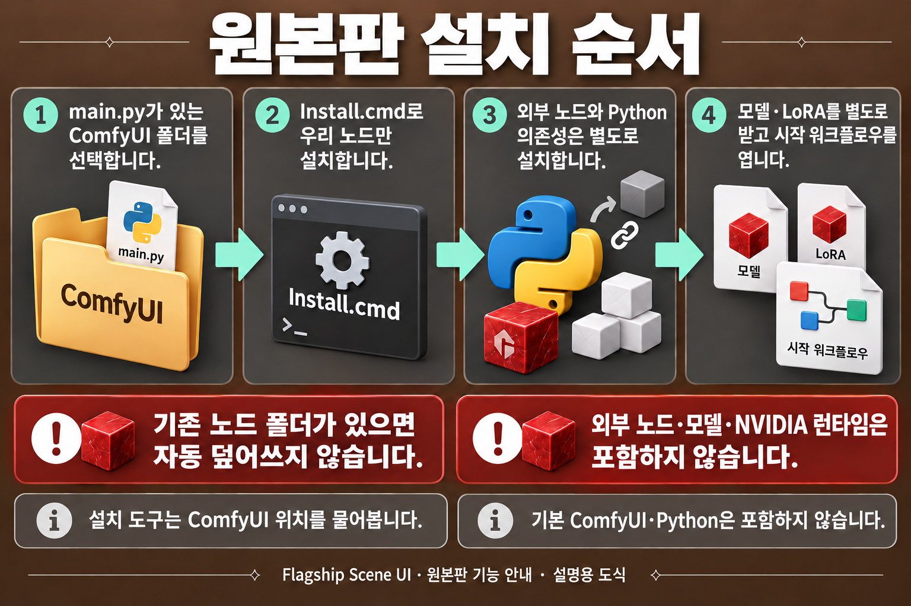

1. H3를 지원하는 새 ComfyUI의 main.py 폴더를 선택합니다.
2. 원본 노드와 해당 Python의 의존성을 설치합니다.
3. 모델·LoRA는 별도로 받고 시작 워크플로우를 불러옵니다.

native 설치 도구에 main.py가 있는 ComfyUI 폴더를 지정합니다. 이미 같은 노드 폴더가 있으면 덮어쓰지 않고 멈춥니다. 해당 Comfy Python에 요구 패키지를 설치하고 모델·LoRA를 링크에서 받아 실제 파일명을 선택합니다. 새 시작 워크플로우에는 개인 자료나 프로젝트가 없습니다. Git 소스판은 보호된 이미지 업스케일 바이너리를 제외하며 전체 네이티브 배포 ZIP에는 기존 바이너리가 별도 고지되어 있습니다. NVIDIA 런타임·가중치는 어느 패키지에도 없습니다.

## 헷갈리기 쉬운 구분

| 구분 | 의미 |
| --- | --- |
| Comfy 워크플로우 JSON | Comfy에 불러오는 노드 연결 파일 |
| 계획 JSON | UI 안의 JSON 불러오기로 여는 scenes/clips/settings/references |
| 참고 오디오 / 립싱크 오디오 | 참고 조건 / 프로젝트 전체 시간축의 트랙 |
| 참고 LoRA / 음성 LoRA | 참고 적응 LoRA는 음성 전용 학습 파일이 아님 |
| 선택 클립 생성 / 이 클립부터 재생성 | 한 클립 / 선택 번호 이후 전체 예약 |
| 일반 / 시퀀스 합치기 | 클립 FFmpeg / 씬 안 Endless 후 씬 사이 FFmpeg |

## 문제를 찾을 때

프로젝트·씬·클립 번호, 실제 설정, 오류 로그를 함께 확인합니다. 누락 입력은 현재 씬의 참고 목록과 실제 파일부터 확인합니다. 원본 생성과 업스케일 파일을 구분하고 캐시·리파이너·리페어를 동시에 바꾸지 않습니다. 노드 등록 성공이 모든 모드의 추론 성공을 뜻하지는 않습니다.
